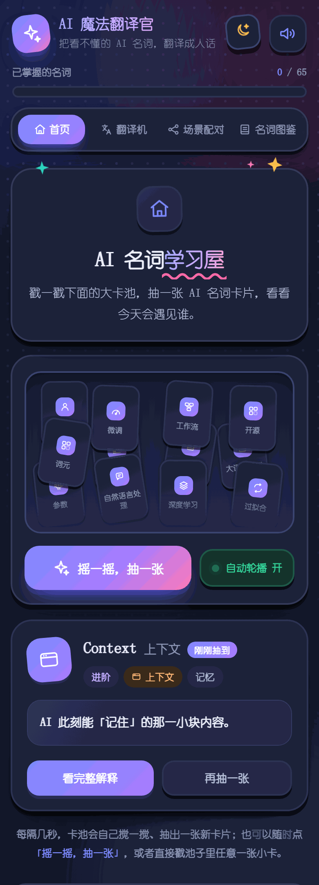
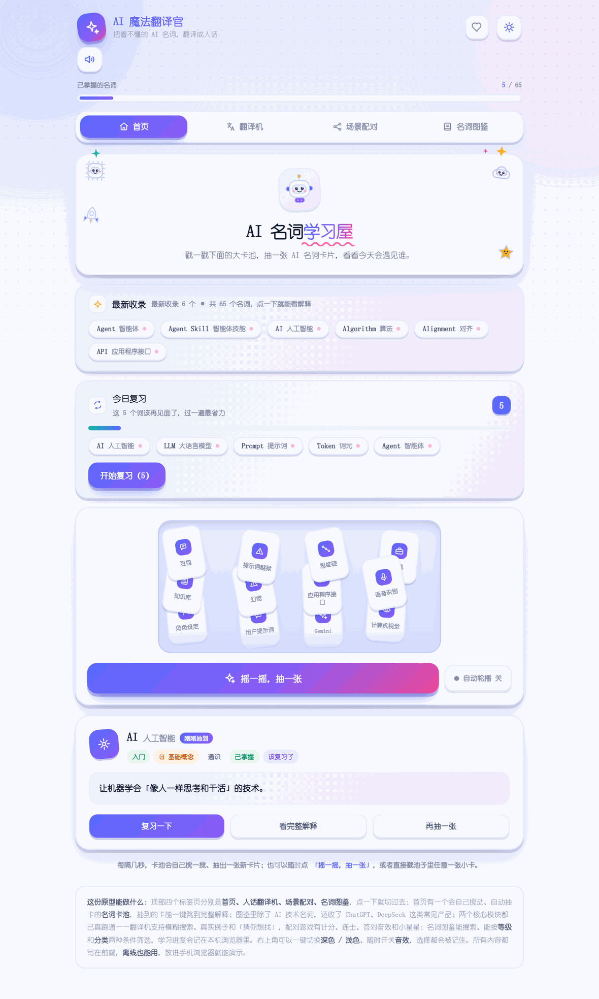
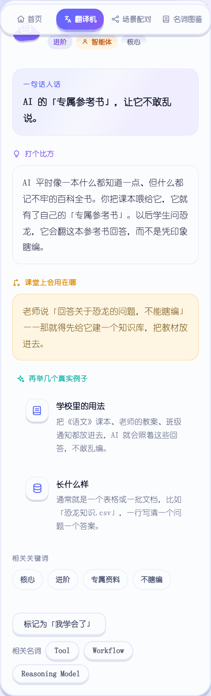
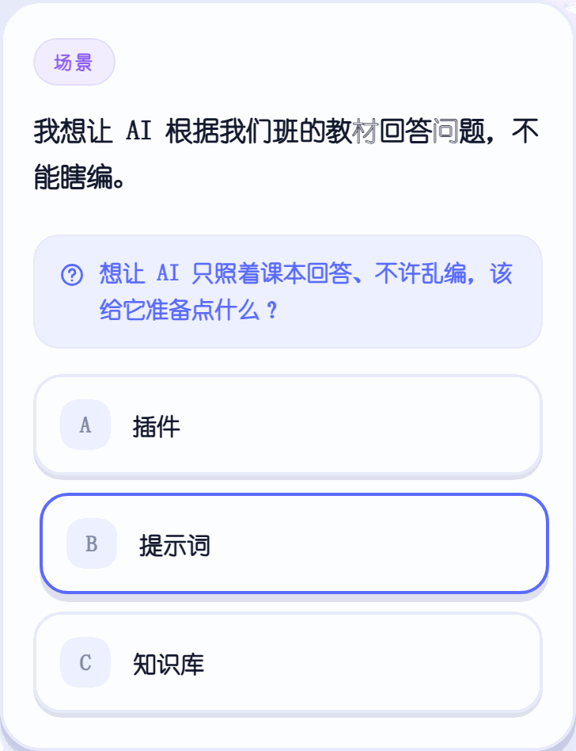
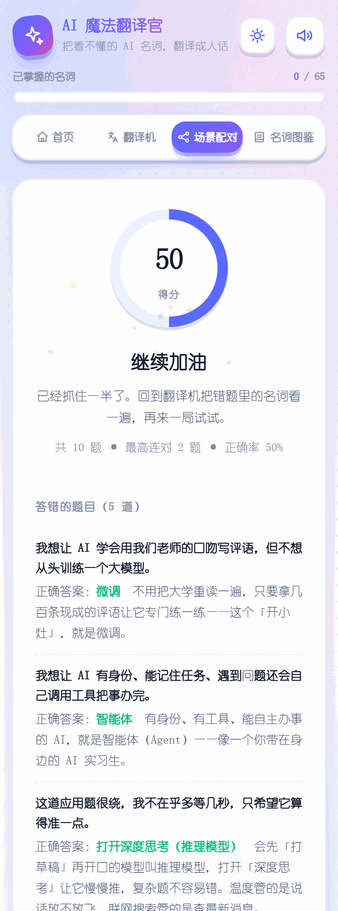
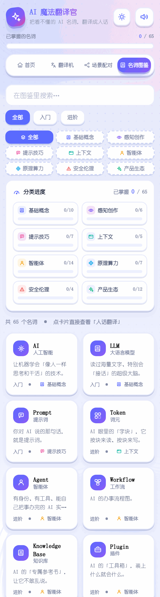
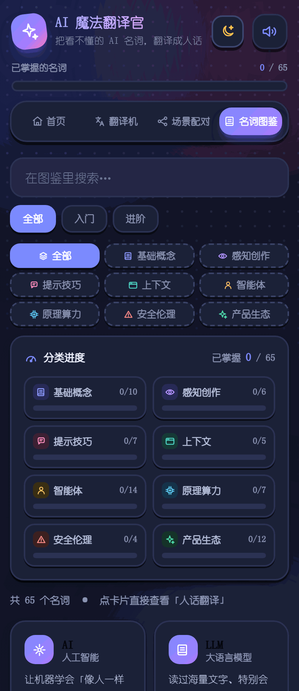
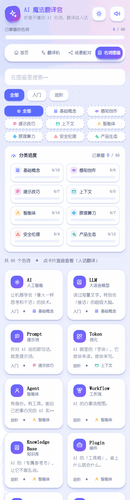
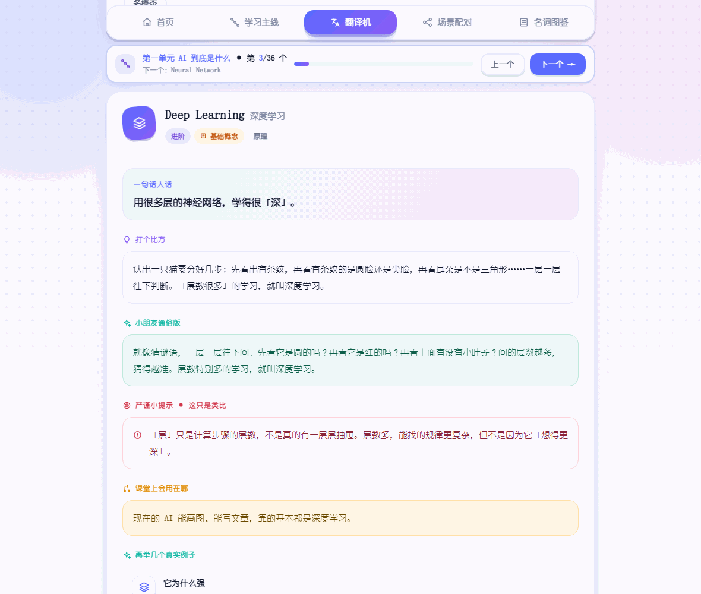

# 界面截图

共 17 张，覆盖五个标签 + 深浅两色 + 手机/桌面两档布局。

| 截图 | 界面 | 说明 |
|---|---|---|
|  | **首页 · 名词卡池** | 一堆名词卡沉在池底缓缓搅动，点一下随机抽一张（104 KB） |
|  | **首页 · 深色模式** | 深浅色双主题，适合不同教室设备（102 KB） |
|  | **首页 · 今日复习** | 按记忆曲线算出今天到期该复习的词（137 KB） |
|  | **翻译机** | 输入听不懂的词，返回三段式人话解释（95 KB） |
|  | **翻译机 · 三段式释义** | 一句话 + 打比方 + 真实例子（76 KB） |
|  | **翻译机 · 深色** | 同一界面在深色主题下的样子（100 KB） |
|  | **翻译机 · 模糊搜索** | 记不准全名也能命中，没有结果时给「猜你想找」（131 KB） |
|  | **场景配对** | 给一个真实场景，选出该用哪个 AI 名词（22 KB） |
|  | **场景配对 · 即时反馈** | 答对有小星星和音效，答错会讲为什么（79 KB） |
|  | **场景配对 · 结算** | 答完可回看错题与原因（97 KB） |
|  | **名词图鉴** | 按分类 + 等级双条件筛选全部词条（118 KB） |
|  | **名词图鉴 · 深色** | 图鉴的深色模式（79 KB） |
|  | **图鉴 · 掌握进度** | 每个分类掌握到哪一目了然（120 KB） |
|  | **学习主线** | 四个单元，从「AI 是什么」一路走到「让它自己干活」（61 KB） |
|  | **学习主线 · 单元导航** | 单元之间可直接跳转（42 KB） |
|  | **桌面版 · 首页** | 宽屏下的首页布局（64 KB） |
|  | **桌面版 · 翻译机** | 宽屏下的翻译机（65 KB） |

> 全部截图来自真实浏览器渲染，非设计稿。
